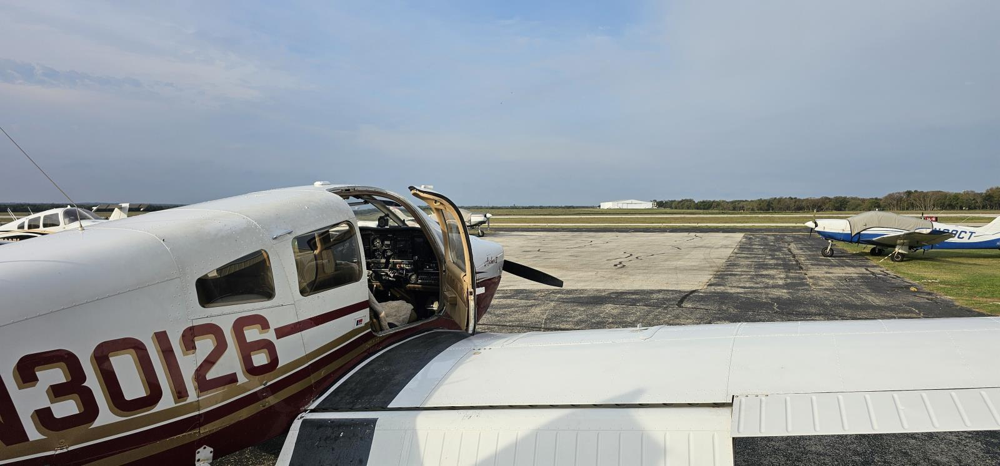

+++
title = "Flight Log 2026-11-07: Just Look Out The Front Window"
date = 2026-11-07
[taxonomies]
	tags = [ "Aviation", "Flight Training", "Flight Log" ]
[extra]
applet = true
+++


09:13-09:15 | engine | Simulated Engine failure | start-alt
09:20-09:23 | sturns | S-Turns | alt-dev gs-dev
09:25-09:31 | turns1 | Turns Around A Point | alt-dev gs-dev
09:36:40-09:40:34 | turns2 | Turns Around A Point | alt-dev gs-dev
09:40:35-09:41:36 | engine2 | Simulated Engine Failure | start-alt



This is the first of what I hope will be a semi-regular series of flight logs. Not every flight, just the ones I find interesting or learn something from. The track above comes straight from my logbook; click any of the numbered annotations (or the highlighted links in the text) to jump to that part of the flight.


I've gotten to a point in my flying ability where altitude control is mostly automatic, but only as long as I'm not thinking about it.

It's an odd thing. It's one of the most eminently measurable aspects of flying. Most of the maneuvers in the ACS[^1] have a tolerance for altitude deviation, and since altitude MSL is altitude MSL, it's very easy to review after the fact and judge your performance. Because of this, I like to do a good job. And because I try to do a good job, I sometimes don't. But if I just look out the front window, give my brain some visual data, and just let it do its thing... it usually seems to work out fine.

I've noticed a similar thing in sim racing as well. I perform so much better when I focus my vision on the apex of a corner. But eventually, my eyes wander. Then the car's balance shifts, or I catch another car (or they catch me) and I have to remind myself to look in the right place. Maybe this is what athletes mean when they say "keep your eye on the ball." And given how often I hear it repeated, perhaps this is just a thing humans struggle with in general, as if the control of our eyes has only been partially delegated to the activity-specific neural network we've spent so much time building.

Today was supposed to be my first solo out to the practice area, but the weather didn't work out. I tell myself I'm in no hurry, but I definitely was disappointed. I felt ready. But because my life is hectic and I only barely have enough time to make progress towards my PPL as it is, we decided to make the best of the low ceilings and do something for currency reasons. And that something was ground reference maneuvers.

But of course, we had to start with {{ mark(key="engine", text="an engine failure") }}. Because no training flight in a single-engine aircraft is complete without a simulated engine failure. I fortunately have a CFI who knows this and regularly catches me completely off guard with them. Today, I got every memory item, picked a great field, and made a good approach. But in doing so, I was flying right towards a radio tower. To be fair, I wasn't going to hit it, but we got close enough that my CFI decided to prompt me to turn a bit early in the interest of not violating [§ 91.119](https://www.ecfr.gov/current/title-14/section-91.119). The fact that I didn't see it until my EFB started showing collision alerts was at least a little bit alarming. In hindsight, not seeing something right in front of me was very thematic.

After a successful conclusion of that exercise, we started with some {{ mark(key="sturns", text="S-turns") }}. My first turn was where almost all of my ±91 ft of deviation occurred. The rest were far better. And, to be fair to myself, 91 ft of deviation is within ACS standards. But who wants to just barely meet the standards? My CFI pointed it out after the maneuver and it was very obvious watching the video back after the fact: I spent a lot of time fixating on the road, and the rest of the time peeking at the altimeter. At least my ground track was pretty dang even from turn to turn despite at least 12-15 knots of wind at that altitude.

Then we moved on to the {{ mark(key="turns1", text="first turns around a point") }}. I wasn't happy with my performance. My altitude control was better, but once again, I wasn't looking in the right spot. I picked some reference points along the ground, but I bounced between those and the altimeter once again, and when some of those reference points weren't working out I stubbornly refused to pick new ones. I also was thinking way too mechanically about my bank angle in relation to my direction of travel and the wind direction. But I've done a fair bit of these, I know how they work, and the last several I did were perfect. So I was a bit at a loss.

To be clear, I don't think I did *terribly*. I just knew that I was performing nowhere near my capabilities. And that is a weird thought to be having when you know you were feeling pretty ready to solo earlier that morning.

So, I steeled myself to do better. And I decided that what I needed to do in order to do better was to frankly... just chill the heck out and relax. Basically, just not try so hard.

We set up for {{ mark(key="turns2", text="the next set of turns around a new point") }}, and I spent a much larger percentage of my scan just looking out the front window. And, shocker, it was beautiful. Pretty much a pair of perfect circles with only ±46 ft of deviation. I just thought less, and let my hands and feet do the work. In the video, the altimeter needle appeared to be practically glued to the face of the dial. Of course I didn't get to enjoy it at the time, because I wasn't looking at it often enough to notice.

I was relieved, perhaps a bit elated, and proud. I got to enjoy these feelings for about 100 ms because, shocker, my CFI {{ mark(key="engine2", text="failed the engine") }} before I even rolled wings level. Which was probably the best point in the whole lesson to do it. Being at about 1,000 ft AGL during a ground reference maneuver gives you about a minute to get on the ground at best glide. And fortunately I had picked out a field before we started the maneuver, so it didn't take a whole lot of thought to figure out where to put the plane.

And this brought me to a tangent that sent me down a bit of a rabbit hole. My CFI always dings me for picking a field against the furrows, and always gives me points for landing into the wind. But it seems like every time I pick a field, the wind runs across the furrows, often enough that I got suspicious it wasn't happenstance.

As it turns out, I might be right. Wind erosion is worst when furrows run along the prevailing wind[^2], so fields tend to be plowed across it. That means the two rules of thumb are often at odds: landing with the furrows keeps you from flipping the airplane, but landing into the wind gives you less energy to get rid of. And it's a lot less. At 2,550 lb and a 55-knot touchdown, a 13-knot headwind takes the energy from about 463 kJ down to 270 kJ, roughly 40% less. I'll take a higher chance of flipping with 40% less energy over betting I can land neatly between the furrows, especially since some furrows are tall and some fields are rough enough that direction barely matters. My gut says the furrows only win when the wind is under about 5 knots (hopefully I never have to find out).

---

I know full well that I'm a bit of a perfectionist. Probably to the degree that it doesn't serve me, and tends to detract from the things I enjoy more than it improves them. During our debriefings, I always write down all the things I messed up and want to do better on. And if you looked at these lists over time from a purely quantitative standpoint, you'd think I was becoming a worse pilot. I definitely have more mistakes written down from recent flights than I did at the start. I don't think I'm actually making more mistakes than I used to. I've just gotten good enough to notice the small ones.

And the mistakes, individually, are becoming increasingly minor. Certainly not optional, but small enough that not many of them would be likely to be a hole in the Swiss cheese[^3] by themselves. And I often wonder what to do with them. Usually it's a little change to a checklist here, or focusing on a specific thing when I'm chair-flying or practicing on a simulator afterwards. But a lot of them are things that I just re-read before the next flight and trust my brain to not make again. And I rarely make the same one twice in a row.

I've gotten to the point with many other skillsets where I stop thinking about what I'm doing, because I've programmed that behavior into my brain. I don't necessarily need to supervise it consciously anymore. It's a fun place to be, but any time those skillsets involve dangerous activities, it's often hard to let go and trust yourself to *do the thing*. It's also complicated by the fact that aviation has a mixture of tasks, and many of them *shouldn't* be offloaded in this manner. Checklists, decisions, and visually avoiding hazards to name a few. Letting the stick-and-rudder neurons do their job with less conscious supervision will hopefully free up some capacity to supervise other things.

I think my biggest takeaway for the next flight is that I should look out the front window a bit more, and worry about everything else a bit less.

 
 

[^1]: The FAA's [Airman Certification Standards](https://www.faa.gov/training_testing/testing/acs), which define the tolerances a pilot has to fly within on a checkride.

[^2]: W. S. Chepil, F. H. Siddoway and D. V. Armbrust, [*Prevailing Wind Erosion Direction in the Great Plains*](https://infosys.ars.usda.gov/WindErosion/publications/Andrew_pdf/811.pdf).

[^3]: James Reason's [Swiss cheese model](https://en.wikipedia.org/wiki/Swiss_cheese_model) of how accidents happen: every layer of defense has holes, and an accident only gets through when the holes in enough layers line up.
